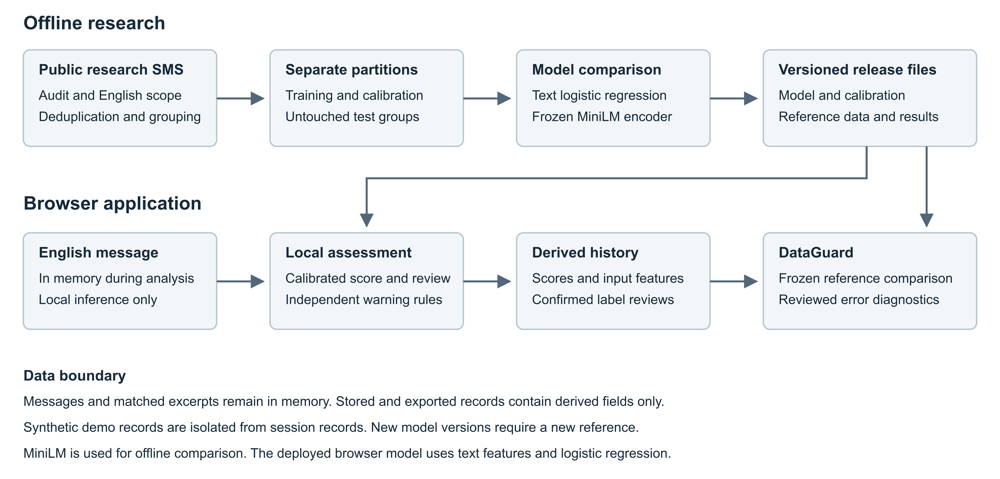

# ScamShield AI and DataGuard

**Final Technical Report**

English SMS phishing assessment and model monitoring

Release 0.2.0 | 7 November 2026

## Executive assessment

ScamShield AI combines a browser-based SMS phishing classifier with visible warning rules and DataGuard monitoring. This release includes a reproducible data audit, two trained classifier comparisons, a calibrated review policy, controlled monitoring experiments, robustness diagnostics, and a locally verified application. All supported workflows and report content are in English.

The deployed text classifier obtained 86.21% precision, 55.56% recall and 67.57% F1 on a separate test partition containing 219 messages. These figures use a fixed score threshold of 0.5 and include every test message. The modest recall is a material operating limitation: this system must not be used to decide that an unflagged message is safe.

The application uses a more cautious decision policy. Scores in an intermediate range, very short inputs and weak vocabulary coverage lead to human review. On the test partition, this policy made decisions for 179 messages and referred 40 for review. Of the 45 phishing messages, 19 were flagged, 24 were referred, and 2 received a non-smishing decision. Review referrals are unresolved outcomes, not successful detections.

The result is a complete, bounded research implementation and an inspectable decision-support tool. It is not a validated autonomous fraud-prevention service. Its value is the connection between measurable detection, visible uncertainty and auditable monitoring; the experiments do not establish future accuracy through 2030.

| Release evidence | Measured result |
| --- | --- |
| English-scope corpus after audit | 1096 messages in 948 approximate template groups |
| Disjoint training, calibration and test partitions | 658 / 219 / 219 messages |
| Deployed classifier at threshold 0.5 | Precision 86.21%; recall 55.56% |
| Policy decision coverage | 81.74%; 40 messages referred for review |
| Known test misses after the review policy | 2 of 45 phishing messages received a non-smishing decision |
| Verification | 27 JavaScript and 15 Python tests passed |

## 1 Purpose and supported use

The application helps a person inspect an English SMS message and helps an operator understand changes in the model's inputs and reviewed outcomes. Phishing messages may imitate trusted organizations and request credentials, payments or other harmful actions. Short text alone often does not provide enough evidence to establish the sender's identity or intent.

The classifier targets the SmishX dataset's smishing label. The negative class combines the source's legitimate and spam labels. This mapping preserves the distinction between unsolicited advertising and phishing. A non-smishing model output is not an endorsement of the sender, a statement that an advertisement is harmless, or a finding that a payment request is legitimate.

The supported input is plain English text, up to 12,000 browser characters. The product provides a model assessment, numerical vocabulary coverage, a reason when it abstains, signed feature contributions and independent rule matches. Users can propose and explicitly confirm a label, inspect their local monitoring history, export derived records or clear history. DataGuard measures model input differences and confirmed prediction errors separately.

The release does not verify caller identity, fetch message URLs, consult domain reputation, inspect images, analyze calls, support additional languages or block transactions. It performs no automatic retraining on user feedback. These boundaries are deliberate: the available data and experiment design support a narrower text-based investigation.

## 2 System architecture

The system has an offline research pipeline and a static browser application. The pipeline audits source records, fixes evaluation partitions, fits models, calibrates their outputs and exports numerical artifacts. The browser loads the compact lexical model and its matching monitoring reference. Inference and review calculations execute locally without an external AI inference request.

The analyzer processes the current message in memory. The model produces a calibrated score, an underlying binary decision and a displayed decision that can be review. Independent warning rules identify visible patterns such as credential requests, urgency and selected URL shapes. The rule index is not mixed into the learned model probability and is not presented as a fraud probability.

History records preserve numerical features, scores, prediction fields, timestamps, version identifiers and optional confirmed labels. They exclude the raw message, matched excerpts, message URLs and feature explanations. DataGuard accepts only records for the current model version. A fixed training reference prevents the comparison baseline from silently changing as local history rolls over.

The application is buildless HTML, CSS and JavaScript. Python handles offline model development and experiment reproduction. The comparison encoder is not shipped to the browser. Static hosting delivers the application and model files. The application is configured for owner-private hosting. Release 0.2.0 was verified locally before publication; the accompanying release manifest records the deployment result.

## 3 Data provenance and audit

The current phishing experiments use the authors' SmishX research release associated with SOUPS 2025 [1, 2]. The upstream paper describes a curated set of 1,200 messages with legitimate, spam and phishing labels. It reports independent coding followed by reconciliation, includes a small personal-archive contribution, and selects messages with active URLs or no URLs. That selection affects the population represented by the experiment.

The CSV was retrieved at a pinned repository revision and checked against a SHA-256 digest. The audit validates labels, removes normalized exact duplicates and excludes conflicting-label groups if encountered. Normalization applies Unicode NFKC, lowercasing, removal of selected zero-width characters and whitespace normalization. It does not use the outcome of a trained classifier to select examples.

| Audit stage | Count |
| --- | --- |
| Source rows | 1200 |
| Duplicate rows removed | 93 |
| Conflicting-label rows excluded | 0 |
| Non-English or corrupted rows excluded after inspection | 11 |
| Retained research messages | 1096 |
| Approximate template groups | 948 |
| Groups containing multiple messages | 80 |
| Largest group | 14 |
| Exact normalized overlap with historical UCI corpus | 509 |

Eleven inspected non-English or corrupted records were excluded before splitting. This is a documented scope filter, not a reliable automatic language detector. Short colloquial messages and transliterated words remain a source of language uncertainty. The user interface requests English and does not advertise support for any other language.

Template grouping masks URLs, email addresses and digit sequences. Exact masked templates are joined, and messages with at least six tokens are also joined when their word-trigram Jaccard similarity is at least 0.8. Connected components become split groups. These are approximate text-template groups, not independently verified attack campaigns. Some relationships can remain undetected, while transitive joins can merge loosely related templates.

The CSV's URL, phone and email metadata each contain two malformed values. These fields are excluded from training. The audit found 509 exact normalized overlaps with the historical UCI SMS corpus, so the old UCI spam result is not treated as an independent evaluation of the new classifier. No separate UCI corpus or trained UCI parameters were added to the new smishing pipeline.

The released CSV has no usable per-message timestamps, source identifiers or campaign identifiers. Consequently, the evaluation makes no chronological, source-held-out or verified-campaign generalization claim. The authors' repository carries an MIT notice, but rights over each underlying message have not been independently established. Raw corpus records stay outside the application and source archive; the project distributes model parameters and aggregate research results.

| Source label | Original rows | Retained rows |
| --- | --- | --- |
| Legitimate | 622 | 604 |
| Spam | 319 | 267 |
| Smishing | 259 | 225 |

## 4 Evaluation protocol

The protocol uses five-fold StratifiedGroupKFold with seed 2030, stratifying on the original three labels while keeping approximate template groups intact [6]. Fold zero is the test set, fold one is the calibration set and folds two through four form the training set. The split manifest records hashes, group identifiers and assignments without message bodies. Reproduction rejects a changed manifest under the same protocol.

The classifier parameters and review thresholds were fixed before test evaluation. Both candidates use logistic regression with C equal to 1. There was no search over test scores and no threshold optimization against the test partition. Vocabulary and inverse document frequency are fitted only on training text. The calibration mapping uses only the calibration partition. Test results and error analysis are reported after fitting.

Approximate group separation reduces one common source of leakage, but it cannot eliminate unknown source overlap or guarantee independence. The pretrained encoder may have encountered related public text during its original training. No representation from the previous UCI classifier is transferred into either new candidate.

| Partition | Legitimate | Spam | Smishing | Total |
| --- | --- | --- | --- | --- |
| Train | 362 | 161 | 135 | 658 |
| Calibration | 121 | 53 | 45 | 219 |
| Test | 121 | 53 | 45 | 219 |

There are 571 training groups, 191 calibration groups and 186 test groups, with no group shared between partitions. Precision is the fraction of flagged examples labelled smishing. Recall is the fraction of smishing examples flagged. F1 combines precision and recall. Average precision summarizes ranking performance over recall levels; accuracy alone is insufficient because 174 of 219 test messages are non-smishing.

The report includes 95 percent Wilson intervals for selected proportions and a 1,000-resample group bootstrap interval for F1. Wilson intervals assume independent messages and can understate uncertainty when templates remain dependent. The group bootstrap partially addresses the known grouping structure. Neither interval accounts for all dataset selection and annotation uncertainty.

## 5 Models and uncertainty policy

### Deployed lexical classifier

The deployed model concatenates two TF-IDF feature blocks. One represents word unigrams and bigrams; the other represents character sequences of three through five characters. Each block uses sublinear term frequency, learned inverse document frequency and separate L2 normalization. Terms must occur in at least two training documents. Feature limits are 12,000 word terms and 20,000 character terms; the fitted artifact contains 2,438 word features and 19,179 character features.

The preprocessing pipeline normalizes text, masks URLs, email addresses and digit sequences, and retains ASCII text for the lexical representation. Masking reduces reliance on specific addresses and identifiers, but also discards potentially useful reputation evidence. Word coverage is the fraction of processed word tokens present in the training vocabulary.

Logistic regression combines the feature values with learned coefficients and an intercept. The browser implementation reproduces this arithmetic using the exported parameters. Signed contributions expose which present features increase or decrease the model's logit. They explain the calculation, not the sender's true intention. Character fragments can be difficult for a person to interpret; the separate rule evidence supplies readable context without claiming that it explains the learned model causally.

### Frozen encoder comparison

The second candidate encodes processed text with the English all-MiniLM-L6-v2 model and trains a logistic-regression head on the resulting 384-dimensional vectors [4]. Encoder weights remain frozen. Inputs are truncated at 256 word pieces. The exact downloaded model revision is recorded for reproduction.

The lexical model was chosen for browser deployment before the held-out comparison because its numerical artifact is small and inference needs no external AI service. MiniLM serves as a research comparison. Its lower score on this particular split does not establish that lexical methods are generally superior to pretrained language models.

### Calibration and review

A separate regularized sigmoid mapping converts each classifier's logits to calibrated scores [5]. The application refers a message for review when it contains fewer than three processed words, its lexical coverage is below 20 percent, or its calibrated score is strictly between 0.25 and 0.75. Boundary scores of 0.25 and 0.75 are accepted when the coverage and length conditions hold. These fixed thresholds were not shown to be optimal.

The policy separates a displayed review decision from the underlying threshold-0.5 decision used for complete-set diagnostic evaluation. Confirmed review labels enter local performance calculations only after an explicit confirmation action. Accepted-decision metrics exclude abstentions and report their coverage; separate all-reviewed binary metrics include them. The same lexical coverage gate is used for the MiniLM comparison, which is a comparability choice rather than an embedding-based uncertainty estimator.

## 6 Held out model results

The following comparison uses the same 219-message grouped test partition for all candidates. Precision, recall and F1 use the calibrated score at a threshold of 0.5, without excluding uncertain messages. Average precision is calculated with scikit-learn's average_precision_score; it is not a trapezoidal interpolation of the precision-recall curve.

| Candidate | Precision | Recall | F1 | Average precision |
| --- | --- | --- | --- | --- |
| Text logistic regression | 86.21% | 55.56% | 67.57% | 89.40% |
| Frozen MiniLM plus logistic regression | 74.19% | 51.11% | 60.53% | 80.70% |
| Always non-smishing | Undefined | 0.00% | 0.00% | 20.55% |

| Candidate | True positive | False positive | True negative | False negative |
| --- | --- | --- | --- | --- |
| Text classifier | 25 | 4 | 170 | 20 |
| Frozen MiniLM | 23 | 8 | 166 | 22 |
| Always non-smishing | 0 | 0 | 174 | 45 |

The lexical classifier's accuracy was 89.04%, compared with 86.30% for MiniLM and 79.45% for an always-negative rule. The lexical classifier flagged 25 of 45 phishing messages and missed 20 at the standard threshold. It falsely flagged 3 of 121 legitimate messages and 1 of 53 spam messages. The MiniLM candidate missed 22 phishing messages and falsely flagged 8 non-smishing messages.

The lexical model's 95 percent Wilson precision interval is 69.44% to 94.50%; its recall interval is 41.18% to 69.06%. Its group-bootstrap F1 interval is 44.89% to 90.00%. The comparison model's F1 interval is 39.02% to 83.33%. These broad, overlapping intervals support cautious interpretation rather than a claim of a definitive model-family advantage.

| Calibration measure | Text classifier | Frozen MiniLM |
| --- | --- | --- |
| Brier score before calibration | 0.0903 | 0.0913 |
| Brier score after calibration | 0.0607 | 0.0791 |
| Decision coverage with review policy | 81.74% | 80.37% |
| Accepted decisions / referred for review | 179 / 40 | 176 / 43 |
| Errors among accepted decisions | 2 / 179 | 6 / 176 |

Lower Brier scores indicate improved probabilistic prediction on this split, but Brier score measures discrimination and calibration together. The lexical score bin from 0.2 to 0.4 contains 29 messages with a mean score of about 0.325 and an observed phishing fraction of about 0.552. This remaining mismatch shows why a calibration step must not be presented as a universal probability guarantee.

The review policy changes the operational interpretation. The lexical model accepted 19 positive decisions and 160 negative decisions. Of those negatives, 2 were phishing. Among the 40 referrals, 24 were phishing and 16 were non-smishing. Accepted-only accuracy is 98.88 percent, but it applies to 179 selected messages and excludes 40 unresolved cases. Accepted-only recall is also conditional on selection and must not replace the 55.56 percent full-set recall in a headline claim.

The earlier UCI Naive Bayes model remains an archived spam benchmark in Model Lab. Its 93.83 percent spam F1 describes a different label task and a different historical random split. It is not included as a competing phishing result in the tables above.

## 7 DataGuard monitoring design

Input change and prediction failure are separate questions. DataGuard compares message length, word count and URL count with a versioned reference derived only from the training partition. It waits for at least 30 current model records and uses up to the latest 50. The comparison uses empirical cumulative distributions, so it can identify changes beyond a difference in average values.

For each feature, the observed statistic is the maximum distance between the current and reference empirical distributions. The threshold sums two one-sample Dvoretzky-Kiefer-Wolfowitz bounds and applies a Bonferroni allocation across three features. This accounts conservatively for sampling variation in both sets [7]. The nominal 0.05 level applies to one snapshot under independent sampling. Repeated rolling inspection, template dependence and selective application use can invalidate a lifetime false-alarm interpretation.

Confirmed labels form a separate error stream. Labels are ordered by their review timestamps, and review delay is reported. An abstained message still has a stored binary score-threshold decision for all-reviewed diagnostic metrics; abstentions remain excluded from accepted-decision metrics. Missing labels never count as successful predictions.

The default error warning uses a conservative one-sided Hoeffding comparison between the calibration error reference and the latest 50 confirmed binary errors. Both finite sample sizes contribute to the bound. An exponentially weighted moving average is retained as an exploratory diagnostic, not the default alarm decision [8]. The calibration error reference was measured on the same split used to fit the score mapping, so it can be optimistic and is not an independent future operating baseline.

Old model versions, malformed records, invalid review timestamps and inconsistent binary decisions are excluded. A missing or mismatched reference pauses monitoring rather than inventing a baseline. Versioning protects arithmetic consistency; it does not remove biased feedback or establish label quality.

## 8 Controlled monitoring results

Monitoring experiments use explicitly synthetic inputs and Bernoulli error sequences. Each scenario has 200 seeded streams of 500 events. Change begins at zero-based event 250. Gradual changes develop over 100 events. The experiments measure stable-run alerts, detection counts and event delays, and keep input-change experiments separate from error-change experiments.

The input experiment changes mean word count from 20 to 35 and URL probability from 0.1 to 0.5, with message length related to word count. A 600-row reference and 50-event current windows are checked every 10 events. This is a controlled sensitivity test, not a replay of naturally occurring scam campaigns.

| Input scenario | Streams detected | Median delay in events | Stable run alarm rate |
| --- | --- | --- | --- |
| Stable | Not applicable | Not applicable | 1.00% |
| Abrupt shift | 200 / 200 | 19 | Not applicable |
| Gradual shift | 200 / 200 | 49 | Not applicable |

The error experiment raises the underlying error probability from 0.10 to 0.35. It compares a fixed rolling threshold, EWMA, EWMA with labels arriving 25 events late, and the conservative snapshot bound. Delays are measured among detected streams; undetected streams are reported separately rather than hidden in an average.

| Error detector | Stable run alarms | Abrupt detected | Abrupt median delay | Gradual missed |
| --- | --- | --- | --- | --- |
| Fixed window | 10.50% | 200 / 200 | 26 | 0 / 200 |
| EWMA | 75.50% | 200 / 200 | 9 | 0 / 200 |
| EWMA delayed labels | 73.00% | 200 / 200 | 34 | 0 / 200 |
| Conservative bound | 0.00% | 188 / 200 | 62 | 20 / 200 |

EWMA produced an alarm in 75.50% of stable streams. This is an unfavorable result for the tested three-sigma Bernoulli configuration. Its faster change detection does not compensate for that false-alarm burden in this application. Delaying labels increased the median abrupt-change alarm delay from 9 to 34 events.

The conservative bound produced no alarms in the 200 stable simulation runs, but missed 12 abrupt-change streams and 20 gradual-change streams within the observation horizon. Its median gradual-change delay was 139.5 events among detected runs. Zero observed false alarms in a finite simulation is not a guarantee of zero deployment false alarms.

The conservative method was added after the EWMA failure was observed, using an analytical bound without numerical tuning. Evaluation reused the original streams, so this engineering decision is not an independent confirmation of superiority. Selective human reviews, approximate text groups and a learned calibration baseline further distinguish the application from the complete-label simulation. The release does not claim to solve adaptive concept-drift detection.

### Replay of measured classifier errors

A separate diagnostic replays the actual 219 test predictions and labels in 100 seeded orders, without inventing outcomes. There are 24 binary errors, an error rate of 10.96%, compared with the calibration reference of 6.85%. The conservative monitor alerts in zero of 100 orders with either immediate or delayed labels. EWMA alerts in 98 immediate-label orders and 93 delayed-label orders.

A 25-event review delay leaves 194 labels available by the original horizon, or 88.58% coverage. The default 50-review threshold is 35.23%; its conservatism makes smaller increases difficult to detect. These orderings reuse the same messages and are not new independent datasets. They measure ordering sensitivity, not field false-alarm rates or chronological drift detection.

## 9 Robustness diagnostics

The robustness suite contains authored English examples and controlled variants. It covers direct requests, legitimate payments, warnings about scams, negation, short or ambiguous messages, identifier changes and textual obfuscation. These cases are a diagnostic test set created for this project. They are neither a representative independent population sample nor additional training data.

The suite records full binary decisions, abstentions, accepted-decision errors and paired changes in scores. Ambiguous cases are excluded from binary correctness totals and evaluated for review behavior. Model parameters and thresholds are not adjusted to improve these case scores.

The suite contains 42 examples with intended binary labels and 6 ambiguous examples. On the labelled cases, the classifier recorded 8 true positives, 10 false negatives, 24 true negatives and no false positives. Binary F1 was 61.54 percent and recall was 44.44 percent. These misses are a concrete limit of the current text model.

| Category | Cases | Binary correct | Accepted decisions | Accepted correct |
| --- | --- | --- | --- | --- |
| Credential Request | 6 | 50.00% | 2 | 0.00% |
| Advance Fee | 6 | 16.67% | 3 | 0.00% |
| Ordinary | 6 | 100.00% | 5 | 100.00% |
| Legitimate Fee | 6 | 100.00% | 4 | 100.00% |
| Negated Warning | 6 | 100.00% | 6 | 100.00% |
| Advertising | 6 | 100.00% | 4 | 100.00% |
| Context Limited | 6 | Undefined | 2 | Undefined |
| Obfuscation | 6 | 66.67% | 3 | 66.67% |

The policy accepted 27 of 42 labelled cases and made 6 errors among those accepted decisions. It referred 19 of all 48 cases, including 4 of the 6 ambiguous cases. Two ambiguous examples still received a decision; their correctness is unknown. Coverage and abstention alone are therefore insufficient evidence of trustworthy operation.

All six authored scam-warning and negation examples were assigned the intended non-smishing binary label, but direct credential and advance-fee scenarios remained difficult. Six paired transformations produced one binary prediction flip. Case and whitespace changes and selected zero-width insertions are normalized; separated letters, substitutions and paraphrases can change the representation. This small suite does not establish resistance to arbitrary adversarial text.

The interface exposes independent rule evidence and highlights a disagreement when the model gives a non-smishing decision but the rule concern index is at least 55. That display improvement does not change model parameters, research decisions or the reported metrics.

## 10 Software verification and privacy

Release verification passed 27 JavaScript tests and 15 Python tests. The automated checks cover input boundaries, model inference, preprocessing parity, unknown vocabulary, artifact validation, version filtering, review confirmation, missing labels, distribution comparisons and error calculations. Authored Python-generated fixtures check that browser model arithmetic matches the independent implementation.

Browser verification covered the analyzer, review transitions, session and synthetic-demo separation, Model Lab results, local export, responsive layout and reported browser errors. The exact observations and verification limits are recorded in the release verification file. Test success establishes behavior for the exercised conditions; it is not a security certification or a measure of fraud-detection accuracy.

Message text is not sent to an external inference service and is not stored in application history. The page renders message-derived text using escaped output, and the analyzer does not visit embedded links. Stored records pass an explicit field whitelist. Importing saved state cannot preserve arbitrary message fields, token explanations or URLs in the exported record schema.

Derived metadata can still be sensitive. Scores, timestamps, word counts and labels may reveal patterns of use. Browser-local storage is specific to the device and browser, is not a secure multi-user database, and can be modified by local users or extensions. Clearing history removes current and legacy application history. Hosting and sign-in infrastructure still process ordinary web requests.

Synthetic examples are isolated from real session history, marked clearly and exported with their dataset identity. They may illustrate visible shifts and errors, but never appear as evidence of measured live accuracy. Feedback is not automatically accepted as a training label and cannot silently replace the model.

## 11 Operation and maintenance

The private application address is [ScamShield AI](https://scamshield-ai.obito-2318.chatgpt.site). Release 0.2.0 preserves owner-only access. The accompanying release manifest records the published source revision and deployment result. The source package contains the deployable static application, model artifacts, training scripts, frozen split manifest, tests and experiment results. Raw SMS corpora, downloaded encoder weights, private credentials and local environments are excluded.

For local use, serve the dist directory over HTTP using Python 3.9 or newer and open the local address in a modern browser. JavaScript tests require Node.js 20 or newer. Offline research reproduction uses the pinned Python dependencies listed in ml/requirements-research.txt. The verified research run used Python 3.12.14 on macOS ARM64; timing is hardware-specific.

The model JSON and monitoring reference form a versioned pair. A replacement model needs a new version identifier, a regenerated reference, separate calibration and an untouched evaluation set. Repeatedly improving a model against this report's test set would turn that set into development data. Meaningful future claims require newly collected, appropriately governed evaluation data.

Before promotion, compare candidate false positives, missed phishing, review coverage, subgroup behavior and calibration against the current release. Preserve the previous source commit and matching artifacts for rollback. Deploy the exact verified source state. Rollback restores that complete release; mixing a model with another version's monitoring reference is rejected.

Ongoing maintenance should inspect label quality, model-loading failures, changing vocabulary coverage and review delay. Investigate a warning using the underlying messages through an appropriately governed workflow. Numerical drift does not by itself justify automatic retraining. A low alert rate also does not establish stable detection quality.

## 12 Limitations and development priorities

The principal limitation is missed phishing. At the ordinary binary threshold, the lexical classifier misses 20 of 45 positive test examples. The review policy reduces confident misses in this sample, but depends on a person resolving referred messages. The application has no independently measured human-review accuracy or response-time guarantee.

The dataset is small, curated and partly historical. Active-URL sampling, inherited labels, unknown collection dates and source overlap limit external validity. Approximate template grouping improves the split but does not prove campaign independence. The application has not been tested prospectively on a contemporary, representative stream of English messages.

Masking identifiers and using text alone improve portability and reduce retention, while removing sender and domain evidence. The application cannot establish ownership of an account or identity of a sender. Context-dependent messages, novel impersonation tactics, obfuscation and legitimate fee requests remain difficult. The stress results document examples of these limitations rather than eliminating them.

Monitoring results depend on synthetic choices and selective reviews. The statistical bounds assume conditions that practical browser sessions may violate. The conservative error rule trades detection speed for fewer observed false alarms. It is an investigation aid, not an automated incident declaration.

The next justified development steps are a new governed English dataset with source and time metadata, independent review of a labelled subset, prospective evaluation with delayed labels, and review-policy optimization on development data followed by a fresh test. Domain or sender evidence could be studied as a separately evaluated extension. No additional language support is included in the scope.

Continued usefulness through 2030 depends on these update and evaluation practices. A versioned, reproducible system can be maintained as message patterns change; this report does not claim that a model trained once will remain accurate indefinitely.

<!-- pagebreak -->

## References

1. Wang Y and coauthors. Can You Walk Me Through It Explainable SMS Phishing Detection using LLM based Agents. SOUPS 2025, pages 37 to 56. [Publication and paper](https://www.usenix.org/conference/soups2025/presentation/wang).
2. SmishX authors. Research dataset and supplementary repository, pinned revision 116a8c827741e0572563f678d25ed04306b1e3ff. [Source repository](https://github.com/yizhu-joy/SmishX/tree/116a8c827741e0572563f678d25ed04306b1e3ff).
3. Almeida T A and Hidalgo J M G. SMS Spam Collection. UCI Machine Learning Repository. [Dataset and attribution](https://doi.org/10.24432/C5CC84).
4. Sentence Transformers. all MiniLM L6 v2 model card, revision 1110a243fdf4706b3f48f1d95db1a4f5529b4d41. [Model documentation](https://huggingface.co/sentence-transformers/all-MiniLM-L6-v2/blob/1110a243fdf4706b3f48f1d95db1a4f5529b4d41/README.md).
5. scikit learn developers. Probability calibration. [Official documentation](https://scikit-learn.org/stable/modules/calibration.html).
6. scikit learn developers. StratifiedGroupKFold. [Official documentation](https://scikit-learn.org/stable/modules/generated/sklearn.model_selection.StratifiedGroupKFold.html).
7. Wei F and Dudley R M. Dvoretzky Kiefer Wolfowitz Inequalities for the Two sample Case. 2011. [Author manuscript](https://arxiv.org/abs/1107.5356). This report uses a conservative union of one sample bounds.
8. NIST SEMATECH. EWMA Control Charts. [Engineering Statistics Handbook](https://www.itl.nist.gov/div898/handbook/pmc/section3/pmc324.htm).
9. Hoeffding W. Probability inequalities for sums of bounded random variables. Journal of the American Statistical Association, 1963, volume 58, pages 13 to 30. [DOI](https://doi.org/10.1080/01621459.1963.10500830).

## Appendix Reproducibility record

The experiment result files provide more detail than the rounded tables in this report. The source package includes docs/results/split-manifest.json, docs/results/data-audit.json, dist/data/smishing-metrics.json, dist/data/monitoring-results.json, dist/data/robustness-results.json and docs/results/release-verification.json. The split manifest has hashed message identifiers and contains no raw messages.

The source CSV SHA-256 is 8d65e373b17477c34e8f1c619e6f59d249e8fca21276cabdd03a55d11a469285. The model identifier is smishing-tfidf-v1. The experiment seed is 2030. Reproduction instructions and commands are provided in README.md and ml/MODEL_V2.md. An identical score on a reproduced split confirms repeatability of this experiment, not external validity.

Latency measurements are warmed Python batch throughput. They exclude download and model-loading time and are not browser interaction benchmarks. The lexical result is the median of five test-batch passes; the MiniLM result measures one encoding pass over the corpus. The methods differ, so the numbers are reported only as implementation observations.
